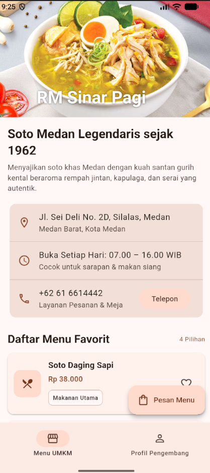
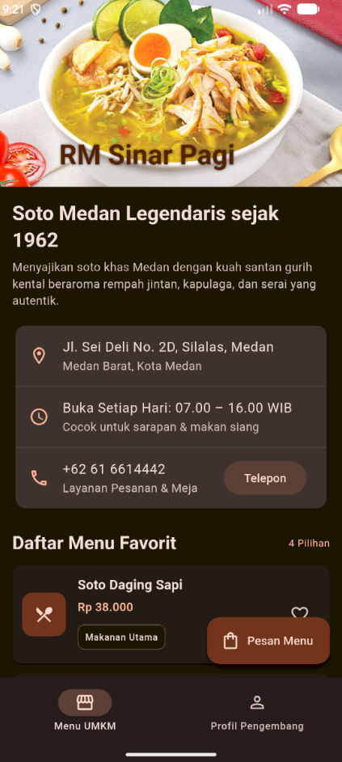
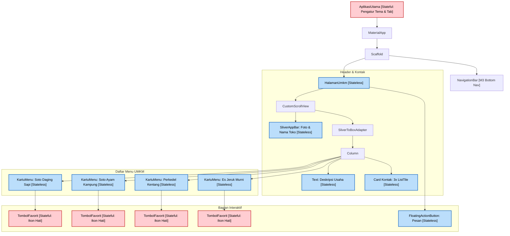

### A. IDENTITAS
- Nama: Muhammad Rafli Wijaya
- NIM: 4243250017
- Kelas: PSIK 24D

### B. Screenshot Mode Terang & Gelap
- Mode Terang

- Mode Gelap

### c. Diagram Widget Tree

Berikut adalah diagram hierarki widget (*Widget Tree*) pada halaman Menu UMKM dengan penanda komponen **Stateless** dan **Stateful**:

> **Keterangan Diagram:**
> * Kotak berwarna **Merah Muda / [Stateful]**: Memiliki data yang dapat berubah saat ditekan pengguna.
> * Kotak berwarna **Biru Muda / [Stateless]**: Komponen tampilan statis yang tidak berubah sendiri.

### D. Penjelasan Arsitektur Tiga Pohon & Alasan Pemilihan Widget (191 Kata)

Di balik layar, Flutter mengelola tampilan menggunakan tiga struktur pohon:
1. **Widget Tree**: Berperan sebagai cetak biru (*blueprint*) konfigurasi antarmuka. Widget bersifat ringan, tidak dapat diubah (*immutable*), dan dibuat ulang setiap kali ada pembaruan tampilan.
2. **Element Tree**: Berperan sebagai jembatan yg menyimpan memori dan mengelola *State*. Pohon ini bertahan lama dan mencocokkan widget lama dengan yang baru agar tidak membuang resource secara percuma atu sia-sia.
3. **RenderObject Tree**: Berperan sebagai pelaksana teknis yang menghitung ukuran dan posisi tata letak (*layout*), lalu menggambar piksel visual ke layar hp atau mobile.

**Alasan Pemilihan Stateless dan Stateful:**
 Antarmuka seperti `HalamanUmkm`, `KartuMenu`, informasi kontak, dan teks deskripsi dibuat sebagai **StatelessWidget**. Alasannya, data tersebut bersifat statis dan tampilannya tidak berubah setelah dimuat, sehingga lebih hemat memori dan cepat.

kemudian, **StatefulWidget** hanya diterapkan pada komponen terkecil yang memiliki interaksi data, yaitu `TombolFavorit` (ikon hati) dan `AplikasiUtama` (untuk tema dan navigasi tab). Dengan memisahkan tombol favorit ke widget kecilnya sendiri, saat tombol ditekan, fungsi `setState()` hanya membangun ulang (*rebuild*) tombol hati itu aja. Bagian kartu menu, gambar header, dan kontak tidak ikut dibangun ulang secara sia-sia, sehingga performa aplikasi tetap mulus.

### Informasi Tambahan
Aplikasi ini menggabungkan hasil Praktikum (Kartu nama digital mahasiswa) dan TR 5 (Menu UMKM kuliner medan) dihubungkan menggunakan komponen modern NavigationBar (Material 3) di bagian bawah layar.

### E. Pernyataan Penggunaan AI
Saya menggunakan ai untuk membantu memberikan gambaran dari file apa aja yg ada di projek aplikasi ini, kemudian harus seperti apa isinya, saya juga menggunakan ai untuk menyatukan halaman pratikum kartu nama dengan halaman tugas rutin kuliner UMKM, saya juga menggunakan ai untuk membuat poin C diagram widget tree dengan kode mermaid.